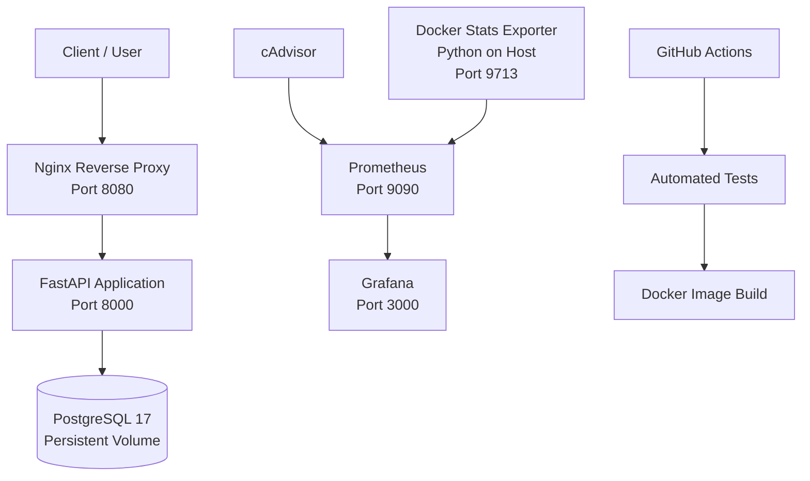

# Docker Multi-Container Inventory Platform

**A containerized inventory platform with persistent storage, automated testing, reverse proxy, and infrastructure monitoring.**

[](https://github.com/defrisdoloksaribu/docker-multi-container-platform/actions/workflows/ci.yml)


**Author:** Defris Doloksaribu  
**Project Type:** DevOps Portfolio Project  
**Repository:** [docker-multi-container-platform](https://github.com/defrisdoloksaribu/docker-multi-container-platform)

---

# 🇮🇩 Bahasa Indonesia

## 1. Deskripsi Proyek

Docker Multi-Container Inventory Platform adalah proyek portofolio DevOps yang mengimplementasikan aplikasi inventaris berbasis REST API menggunakan arsitektur multi-container.

Proyek ini mengintegrasikan **FastAPI** sebagai backend API, **PostgreSQL** sebagai database dengan persistent storage, dan **Nginx** sebagai reverse proxy. Seluruh service aplikasi dikelola menggunakan Docker Compose.

Untuk monitoring infrastruktur, proyek ini menggunakan **Prometheus**, **cAdvisor**, dan **Grafana**. Selain itu, terdapat custom **Docker Stats Exporter** berbasis Python yang mengambil informasi penggunaan CPU, memori, dan status container melalui Docker CLI, kemudian menyediakan metrik untuk dikumpulkan Prometheus.

GitHub Actions digunakan untuk menjalankan automated testing dan membangun Docker image ketika terdapat perubahan pada repository.

Proyek ini dikembangkan sebagai implementasi praktis keterampilan **containerization, infrastructure monitoring, CI automation, database persistence, dan application deployment workflow**.

## 2. Fitur Utama

- **Multi-container architecture:** Mengelola enam service menggunakan Docker Compose.
- **REST API:** Menyediakan endpoint untuk health check dan pengelolaan data inventaris.
- **PostgreSQL persistence:** Menyimpan data menggunakan Docker named volume.
- **Nginx reverse proxy:** Mengatur akses menuju aplikasi API.
- **Container health checks:** Memantau kondisi service yang memiliki health check.
- **Automated testing:** Menjalankan pengujian Python menggunakan pytest.
- **Continuous integration:** Menjalankan testing dan Docker image build melalui GitHub Actions.
- **Infrastructure monitoring:** Mengumpulkan metrik container menggunakan cAdvisor dan Prometheus.
- **Custom Docker Stats Exporter:** Menyediakan metrik CPU, memory, dan status container.
- **Grafana dashboard:** Menampilkan visualisasi status dan penggunaan resource container.
- **Recovery testing:** Menguji pemulihan API setelah container dihentikan dan dijalankan kembali secara manual.

## 3. Arsitektur Sistem



### Service Overview

| Service | Technology | Fungsi |
|---|---|---|
| `api` | Python, FastAPI | Menyediakan REST API inventaris |
| `db` | PostgreSQL 17 | Menyimpan data inventaris |
| `nginx` | Nginx | Reverse proxy aplikasi |
| `cadvisor` | cAdvisor | Mengumpulkan metrik container |
| `prometheus` | Prometheus | Mengumpulkan dan menyediakan query metrik |
| `grafana` | Grafana | Menampilkan dashboard monitoring |

**Komponen tambahan:** Docker Stats Exporter berjalan sebagai proses Python pada host Windows, bukan sebagai service container Docker Compose. Exporter mengambil statistik container melalui Docker CLI dan menyediakan endpoint metrik pada port `9713`.

## 4. Teknologi yang Digunakan

| Kategori | Teknologi |
|---|---|
| Containerization | Docker, Docker Compose |
| Backend | Python, FastAPI |
| Database | PostgreSQL 17 |
| Reverse Proxy | Nginx |
| Monitoring | Prometheus, cAdvisor, Grafana |
| Custom Metrics Exporter | Python |
| Testing | pytest |
| CI | GitHub Actions |
| Version Control | Git, GitHub |

## 5. Instalasi dan Menjalankan Proyek

### Prasyarat

Pastikan perangkat sudah memiliki:

- [Docker Desktop](https://www.docker.com/products/docker-desktop/)
- [Git](https://git-scm.com/)
- Python 3 untuk menjalankan Docker Stats Exporter.

Docker Desktop harus berjalan menggunakan Linux containers.

### Langkah 1 — Clone Repository

```cmd
git clone https://github.com/defrisdoloksaribu/docker-multi-container-platform.git
cd docker-multi-container-platform
```

### Langkah 2 — Konfigurasi Environment

Buat file `.env` berdasarkan template:

```cmd
copy .env.example .env
```

Buka file `.env`, kemudian sesuaikan variabel yang diperlukan berdasarkan `.env.example`, termasuk kredensial PostgreSQL dan password administrator Grafana.

**Penting:** Jangan mengunggah `.env`, password, token, atau secret ke GitHub. Gunakan kredensial yang kuat dan berbeda dari nilai contoh.

### Langkah 3 — Jalankan Platform

```cmd
docker compose up --build -d
```

Perintah ini membangun image aplikasi dan menjalankan service Docker Compose di background.

### Langkah 4 — Periksa Container

```cmd
docker compose ps
```

Periksa status setiap service dan pastikan health check yang tersedia sudah sehat.

Validasi konfigurasi Docker Compose:

```cmd
docker compose config --quiet
```

### Langkah 5 — Jalankan Docker Stats Exporter

Exporter dijalankan secara terpisah pada host Windows.

Buka CMD baru dari direktori proyek:

```cmd
py tools\docker-stats-exporter\exporter.py
```

Jika berhasil, akan muncul pesan bahwa exporter berjalan pada:

```text
http://0.0.0.0:9713/metrics
```

Biarkan jendela CMD tersebut tetap terbuka selama monitoring berlangsung.

Untuk memeriksa endpoint exporter, buka PowerShell baru:

```powershell
Invoke-WebRequest -UseBasicParsing http://localhost:9713/metrics
```

Exporter harus aktif agar Prometheus dapat mengumpulkan metrik yang disediakannya.

### Langkah 6 — Periksa API

Health check:

```cmd
curl http://localhost:8080/health
```

Contoh respons yang telah diperoleh saat pengujian:

```json
{
  "status": "healthy",
  "database": "connected"
}
```

Mengambil data inventaris:

```cmd
curl http://localhost:8080/items
```

Contoh data yang telah diverifikasi selama pengujian:

```json
[
  {
    "id": 1,
    "name": "Keyboard",
    "quantity": 10
  }
]
```

Data contoh tersebut merupakan hasil pengujian lokal, bukan data yang dijamin tersedia pada instalasi baru.

## 6. API Reference

API diakses melalui Nginx pada `http://localhost:8080`.

| Method | Endpoint | Deskripsi |
|---|---|---|
| `GET` | `/health` | Memeriksa kondisi API dan koneksi database |
| `GET` | `/items` | Mengambil daftar inventaris |
| `POST` | `/items` | Menambahkan item inventaris |

### Contoh Menambahkan Item

Jalankan melalui Windows CMD:

```cmd
curl -X POST http://localhost:8080/items -H "Content-Type: application/json" -d "{\"name\":\"Mouse\",\"quantity\":5}"
```

Periksa respons untuk memastikan item berhasil ditambahkan.

## 7. Monitoring dan Observability

Platform menyediakan beberapa endpoint untuk mengakses aplikasi dan monitoring.

| Komponen | URL | Fungsi |
|---|---|---|
| Inventory API | [localhost:8080](http://localhost:8080) | Akses API melalui Nginx |
| Prometheus | [localhost:9090](http://localhost:9090) | Query metrik |
| Prometheus Targets | [localhost:9090/targets](http://localhost:9090/targets) | Memeriksa target monitoring |
| Grafana | [localhost:3000](http://localhost:3000) | Dashboard monitoring |
| Docker Stats Exporter | [localhost:9713/metrics](http://localhost:9713/metrics) | Metrik custom container |

Login Grafana menggunakan username dan password yang dikonfigurasi melalui environment variables.

### Dashboard Grafana

Dashboard monitoring menampilkan informasi berikut:

1. **Container Status:** Status container yang terdeteksi oleh custom exporter.
2. **Container CPU Usage:** Persentase penggunaan CPU setiap container.
3. **Container Memory Usage:** Penggunaan memori container berdasarkan metrik yang dikumpulkan.


### Prometheus Queries

Memeriksa status target cAdvisor:

```promql
up{job="cadvisor"}
```

Memeriksa status target custom exporter:

```promql
up{job="docker-stats-exporter"}
```

Memeriksa status container:

```promql
docker_container_up
```

Memeriksa penggunaan CPU:

```promql
docker_container_cpu_percent
```

Memeriksa penggunaan memori:

```promql
docker_container_memory_usage_bytes
```

Nilai `1` pada metrik `docker_container_up` menunjukkan container terdeteksi sedang berjalan oleh exporter.

**Catatan monitoring:** Metrik dari custom exporter bergantung pada proses Python yang berjalan di host. Jika proses tersebut berhenti, Prometheus tidak dapat mengambil metrik baru dari endpoint exporter. Metrik `docker_container_up` pada implementasi ini mencerminkan container yang dikembalikan oleh `docker stats`; metrik tersebut bukan pemeriksaan independen untuk seluruh container yang sedang berhenti.

## 8. Continuous Integration

GitHub Actions digunakan untuk menjalankan workflow CI ketika terdapat event `push` atau `pull_request` pada branch `main`.

Tahapan workflow:

1. Checkout source code.
2. Setup Python.
3. Install development dependencies.
4. Menjalankan automated tests menggunakan pytest.
5. Membangun Docker image.

### Menjalankan Test Secara Lokal

Dari Windows CMD:

```cmd
docker run --rm -v "%cd%:/workspace" -w /workspace python:3.12-slim sh -c "pip install --no-cache-dir -r requirements-dev.txt && python -m pytest tests"
```

Hasil pengujian lokal yang telah tercatat sebelumnya:

```text
3 passed
```

Hasil tersebut mengacu pada eksekusi pengujian sebelumnya. Periksa GitHub Actions untuk melihat status workflow pada commit terbaru.

**Catatan:** Pipeline yang dijelaskan merupakan continuous integration untuk testing dan Docker image build. Pipeline ini tidak boleh dianggap sebagai automatic deployment ke server produksi.

## 9. Reliability dan Persistence Testing

### API Recovery Test

API diuji dengan menghentikan container dan menjalankannya kembali secara manual:

```cmd
docker compose kill api
docker compose up -d api
docker compose ps api
```

Setelah API dijalankan kembali, endpoint health check diperiksa dan API berhasil merespons kembali.

Pengujian ini membuktikan pemulihan melalui tindakan manual, bukan automatic recovery tanpa intervensi pengguna.

### Database Persistence Test

Container PostgreSQL dibuat ulang tanpa menghapus named volume:

```cmd
docker compose up -d --force-recreate db
docker compose ps
```

Setelah database kembali sehat, periksa:

```cmd
curl http://localhost:8080/health
curl http://localhost:8080/items
```

Data inventaris yang sebelumnya tersedia tetap dapat diakses setelah container database dibuat ulang pada skenario pengujian tersebut.

### Menghentikan Platform

Untuk menghentikan seluruh service tanpa menghapus named volumes:

```cmd
docker compose down
```

Hindari perintah berikut jika data database, metrik Prometheus, dan konfigurasi Grafana masih ingin dipertahankan:

```cmd
docker compose down -v
```

## 10. Struktur Repository

```text
docker-multi-container-platform/
├── .github/
│   └── workflows/
│       └── ci.yml
├── app/
│   ├── __init__.py
│   ├── main.py
│   └── requirements.txt
├── docs/
│   ├── laporan/
│   └── screenshots/
│       └── grafana-dashboard.png
├── monitoring/
│   └── prometheus/
│       └── prometheus.yml
├── nginx/
│   └── default.conf
├── tools/
│   └── docker-stats-exporter/
│       └── exporter.py
├── tests/
├── .dockerignore
├── .env.example
├── .gitignore
├── compose.yaml
├── Dockerfile
├── README.md
├── requirements.txt
└── requirements-dev.txt
```

Struktur di atas menunjukkan file dan direktori utama proyek. Beberapa file dokumentasi tambahan mungkin tersedia di repository.

## 11. Batasan Proyek

- Deployment saat ini berorientasi pada lingkungan lokal menggunakan Docker Compose.
- GitHub Actions menjalankan automated testing dan Docker image build; automatic deployment belum menjadi fitur yang diverifikasi.
- Pengujian pemulihan API dilakukan secara manual.
- Custom Docker Stats Exporter harus dijalankan secara terpisah pada host.
- Metrik status custom exporter hanya mencakup container yang dikembalikan oleh `docker stats`.
- Alerting produksi dan notifikasi belum dinyatakan terverifikasi.
- Konfigurasi cAdvisor dan akses Docker memerlukan peninjauan keamanan sebelum digunakan di lingkungan produksi.
- Backup dan restore database belum dinyatakan teruji.

## 12. Pengembangan Selanjutnya

- Menambahkan integration testing untuk API dan database.
- Mengimplementasikan backup dan restore PostgreSQL.
- Mengembangkan Prometheus alert rules dan notifikasi.
- Meningkatkan keamanan container dan akses monitoring.
- Menyempurnakan custom exporter untuk mendeteksi container stopped.
- Mengembangkan deployment pipeline setelah CI stabil.
- Mengevaluasi orchestration dan automated recovery lebih lanjut.

## 13. Author

**Defris Doloksaribu**

- GitHub: [@defrisdoloksaribu](https://github.com/defrisdoloksaribu)
- Repository: [docker-multi-container-platform](https://github.com/defrisdoloksaribu/docker-multi-container-platform)

---

# 🇬🇧 English Version

## 1. Project Overview

Docker Multi-Container Inventory Platform is a DevOps portfolio project that implements an inventory application using a multi-container architecture.

The platform integrates **FastAPI** as the backend REST API, **PostgreSQL** as the database with persistent storage, and **Nginx** as a reverse proxy. Application services are managed using Docker Compose.

Infrastructure monitoring is implemented using **Prometheus**, **cAdvisor**, and **Grafana**. A custom Python-based **Docker Stats Exporter** collects container CPU, memory, and status information through the Docker CLI and exposes metrics for Prometheus to scrape.

GitHub Actions is used to run automated tests and build the Docker image when changes are pushed to the repository.

This project demonstrates practical skills in **containerization, infrastructure monitoring, CI automation, database persistence, and application deployment workflows**.

## 2. Key Features

- **Multi-container architecture:** Manages six services using Docker Compose.
- **REST API:** Provides health check and inventory management endpoints.
- **PostgreSQL persistence:** Stores application data using a Docker named volume.
- **Nginx reverse proxy:** Routes incoming requests to the API application.
- **Container health checks:** Monitors the health of services with configured health checks.
- **Automated testing:** Runs Python tests using pytest.
- **Continuous integration:** Runs tests and builds the Docker image through GitHub Actions.
- **Infrastructure monitoring:** Collects container metrics using cAdvisor and Prometheus.
- **Custom Docker Stats Exporter:** Exposes container CPU, memory, and status metrics.
- **Grafana dashboard:** Visualizes container status and resource utilization.
- **Recovery testing:** Verifies API recovery after manually stopping and restarting its container.

## 3. System Architecture

The platform consists of six Docker Compose services and one additional Python exporter process running on the host machine.

| Service | Technology | Responsibility |
|---|---|---|
| `api` | Python, FastAPI | Provides the inventory REST API |
| `db` | PostgreSQL 17 | Stores inventory data |
| `nginx` | Nginx | Acts as the application reverse proxy |
| `cadvisor` | cAdvisor | Collects container metrics |
| `prometheus` | Prometheus | Scrapes and queries metrics |
| `grafana` | Grafana | Visualizes monitoring metrics |

The Docker Stats Exporter runs separately as a Python process on the Windows host. It is not a Docker Compose container.

## 4. Technology Stack

| Category | Technology |
|---|---|
| Containerization | Docker, Docker Compose |
| Backend | Python, FastAPI |
| Database | PostgreSQL 17 |
| Reverse Proxy | Nginx |
| Monitoring | Prometheus, cAdvisor, Grafana |
| Custom Metrics Exporter | Python |
| Testing | pytest |
| CI | GitHub Actions |
| Version Control | Git, GitHub |

## 5. Installation and Setup

### Prerequisites

Install the following tools:

- [Docker Desktop](https://www.docker.com/products/docker-desktop/)
- [Git](https://git-scm.com/)
- Python 3 to run the Docker Stats Exporter.

Make sure Docker Desktop is running with Linux containers enabled.

### Step 1 — Clone the Repository

```cmd
git clone https://github.com/defrisdoloksaribu/docker-multi-container-platform.git
cd docker-multi-container-platform
```

### Step 2 — Configure Environment Variables

Create the environment file:

```cmd
copy .env.example .env
```

Edit `.env` and configure the required variables based on `.env.example`, including PostgreSQL credentials and the Grafana administrator password.

Do not commit `.env`, passwords, tokens, or other secrets to the repository. Use strong credentials rather than example values.

### Step 3 — Start the Platform

```cmd
docker compose up --build -d
```

This command builds the application image and starts the Docker Compose services in detached mode.

### Step 4 — Verify Containers

```cmd
docker compose ps
```

Check the status of each service and confirm that configured health checks report healthy.

Validate the Compose configuration:

```cmd
docker compose config --quiet
```

### Step 5 — Start the Docker Stats Exporter

The custom exporter runs separately on the Windows host.

Open a new CMD window in the project directory:

```cmd
py tools\docker-stats-exporter\exporter.py
```

When started successfully, the exporter reports that it is running on:

```text
http://0.0.0.0:9713/metrics
```

Keep this CMD window open while monitoring is required.

Verify the exporter endpoint from a new PowerShell window:

```powershell
Invoke-WebRequest -UseBasicParsing http://localhost:9713/metrics
```

The exporter must be running for Prometheus to collect its metrics.

### Step 6 — Verify the API

Check the application health:

```cmd
curl http://localhost:8080/health
```

Example response observed during testing:

```json
{
  "status": "healthy",
  "database": "connected"
}
```

Retrieve inventory data:

```cmd
curl http://localhost:8080/items
```

Example inventory data observed during testing:

```json
[
  {
    "id": 1,
    "name": "Keyboard",
    "quantity": 10
  }
]
```

This is an example from a local test run. A fresh installation is not guaranteed to contain the same data.

## 6. API Reference

The API is accessible through Nginx at `http://localhost:8080`.

| Method | Endpoint | Description |
|---|---|---|
| `GET` | `/health` | Checks API health and database connectivity |
| `GET` | `/items` | Retrieves inventory items |
| `POST` | `/items` | Adds an inventory item |

### Example: Add an Inventory Item

Run this command in Windows CMD:

```cmd
curl -X POST http://localhost:8080/items -H "Content-Type: application/json" -d "{\"name\":\"Mouse\",\"quantity\":5}"
```

Check the response to verify that the item was created successfully.

## 7. Monitoring and Observability

The platform provides the following application and monitoring endpoints:

| Component | URL | Purpose |
|---|---|---|
| Inventory API | [localhost:8080](http://localhost:8080) | Accesses the API through Nginx |
| Prometheus | [localhost:9090](http://localhost:9090) | Queries monitoring metrics |
| Prometheus Targets | [localhost:9090/targets](http://localhost:9090/targets) | Checks monitoring target status |
| Grafana | [localhost:3000](http://localhost:3000) | Displays monitoring dashboards |
| Docker Stats Exporter | [localhost:9713/metrics](http://localhost:9713/metrics) | Exposes custom container metrics |

Log in to Grafana using the administrator credentials configured through environment variables.

### Grafana Dashboard

The monitoring dashboard provides three main views:

1. **Container Status:** Displays container status detected by the custom exporter.
2. **Container CPU Usage:** Displays CPU utilization for each detected container.
3. **Container Memory Usage:** Displays container memory usage based on collected metrics.


### Prometheus Queries

Check the cAdvisor target:

```promql
up{job="cadvisor"}
```

Check the custom exporter target:

```promql
up{job="docker-stats-exporter"}
```

Query container status:

```promql
docker_container_up
```

Query container CPU usage:

```promql
docker_container_cpu_percent
```

Query container memory usage:

```promql
docker_container_memory_usage_bytes
```

A value of `1` in `docker_container_up` indicates that the exporter detected the container as running.

**Monitoring note:** Custom exporter metrics depend on the Python process running on the host. If that process stops, Prometheus cannot collect new metrics from its endpoint. The current `docker_container_up` metric represents containers returned by `docker stats`; it is not an independent check of every stopped container.

## 8. Continuous Integration

GitHub Actions runs the CI workflow on `push` and `pull_request` events targeting the `main` branch.

The configured workflow includes:

1. Checking out the source code.
2. Setting up Python.
3. Installing development dependencies.
4. Running automated tests with pytest.
5. Building the Docker image.

### Run Tests Locally

Run this command from Windows CMD:

```cmd
docker run --rm -v "%cd%:/workspace" -w /workspace python:3.12-slim sh -c "pip install --no-cache-dir -r requirements-dev.txt && python -m pytest tests"
```

Previously recorded local test result:

```text
3 passed
```

This result refers to an earlier test execution. Check the latest GitHub Actions run for the status of the current commit.

**Note:** The documented pipeline performs continuous integration through automated testing and Docker image building. It should not be considered an automatic production deployment pipeline.

## 9. Reliability and Persistence Testing

### API Recovery Test

The API container was stopped and restarted manually:

```cmd
docker compose kill api
docker compose up -d api
docker compose ps api
```

After restarting the API, the health endpoint was checked and the application responded again.

This test verifies recovery through a manual action. It does not demonstrate automatic recovery without user intervention.

### Database Persistence Test

The PostgreSQL container was recreated without deleting its named volume:

```cmd
docker compose up -d --force-recreate db
docker compose ps
```

After the database became healthy again, the following endpoints were checked:

```cmd
curl http://localhost:8080/health
curl http://localhost:8080/items
```

Previously stored inventory data remained accessible after the database container was recreated in this test scenario.

### Stop the Platform

Stop all services without removing named volumes:

```cmd
docker compose down
```

Avoid using the following command if database data, Prometheus metrics, and Grafana configuration need to be preserved:

```cmd
docker compose down -v
```

## 10. Repository Structure

```text
docker-multi-container-platform/
├── .github/
│   └── workflows/
│       └── ci.yml
├── app/
│   ├── __init__.py
│   ├── main.py
│   └── requirements.txt
├── docs/
│   ├── laporan/
│   └── screenshots/
│       └── grafana-dashboard.png
├── monitoring/
│   └── prometheus/
│       └── prometheus.yml
├── nginx/
│   └── default.conf
├── tools/
│   └── docker-stats-exporter/
│       └── exporter.py
├── tests/
├── .dockerignore
├── .env.example
├── .gitignore
├── compose.yaml
├── Dockerfile
├── README.md
├── requirements.txt
└── requirements-dev.txt
```

This tree summarizes the main project files and directories. Additional documentation files may be available in the repository.

## 11. Known Limitations

- The current deployment is designed for a local Docker Compose environment.
- GitHub Actions performs automated testing and Docker image building; automatic deployment has not been verified.
- API recovery testing was performed manually.
- The custom Docker Stats Exporter must be started separately on the host machine.
- The current custom exporter status metric only covers containers returned by `docker stats`.
- Production alerting and notifications have not been verified.
- cAdvisor configuration and Docker access permissions require security review before production use.
- Database backup and restore have not been documented as tested.

## 12. Future Improvements

- Add API and database integration tests.
- Implement PostgreSQL backup and restore procedures.
- Add Prometheus alert rules and notification integrations.
- Improve container security and monitoring access controls.
- Enhance the custom exporter to detect stopped containers.
- Develop a deployment pipeline after stabilizing CI.
- Evaluate further orchestration and automated recovery capabilities.

## 13. Author

**Defris Doloksaribu**

- GitHub: [@defrisdoloksaribu](https://github.com/defrisdoloksaribu)
- Repository: [docker-multi-container-platform](https://github.com/defrisdoloksaribu/docker-multi-container-platform)

---

*Built as a hands-on DevOps portfolio project focused on container orchestration, CI automation, persistent storage, and infrastructure monitoring.*
