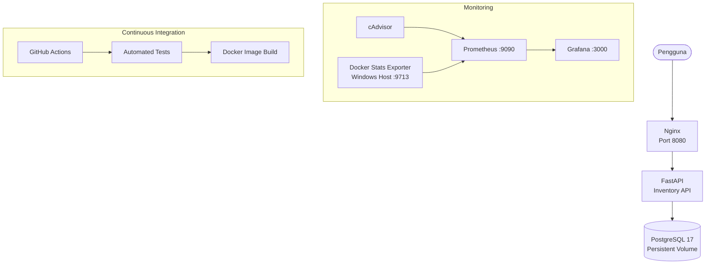

# Docker Multi-Container Inventory Platform

**Platform inventory berbasis Docker dengan REST API, penyimpanan database persisten, CI, dan monitoring terintegrasi.**

[](https://github.com/defrisdoloksaribu/docker-multi-container-platform/actions/workflows/ci.yml)


**Penulis:** Defris Doloksaribu  
**Fokus:** DevOps · Docker · CI · Monitoring  
**Repository:** [docker-multi-container-platform](https://github.com/defrisdoloksaribu/docker-multi-container-platform)

---

## Ringkasan Proyek

Project ini membangun platform inventory menggunakan **Docker Compose** dengan pendekatan multi-container.

FastAPI digunakan untuk menyediakan REST API, PostgreSQL sebagai database dengan penyimpanan persisten, dan Nginx sebagai reverse proxy.

Untuk memantau kondisi container dan aplikasi, project ini menggunakan **Prometheus, cAdvisor, Grafana**, serta custom **Python Docker Stats Exporter**. GitHub Actions digunakan untuk menjalankan pengujian otomatis dan membangun Docker image.

## Arsitektur Sistem



Project ini menggunakan **enam layanan Docker Compose**, yaitu `api`, `db`, `nginx`, `cadvisor`, `prometheus`, dan `grafana`.

Custom Docker Stats Exporter dijalankan secara terpisah pada Windows host, bukan sebagai layanan Docker Compose.

## Teknologi yang Digunakan

| Area | Teknologi |
|---|---|
| Aplikasi | Python, FastAPI |
| Database | PostgreSQL 17 |
| Container | Docker, Docker Compose |
| Reverse Proxy | Nginx |
| Monitoring | Prometheus, cAdvisor, Grafana |
| Custom Metrics | Python Docker Stats Exporter |
| CI | GitHub Actions |
| Testing | pytest |

## Menjalankan Project

**Persyaratan:**
- Docker Desktop dengan Linux containers.
- Git.
- Python 3 untuk menjalankan custom exporter.

Clone repository:

```cmd
git clone https://github.com/defrisdoloksaribu/docker-multi-container-platform.git
cd docker-multi-container-platform
copy .env.example .env
```

Atur credentials pada file `.env`, kemudian jalankan seluruh layanan:

```cmd
docker compose up --build -d
docker compose ps
```

Jalankan custom exporter melalui CMD kedua:

```cmd
py tools\docker-stats-exporter\exporter.py
```

Biarkan proses exporter tetap berjalan selama custom metrics dibutuhkan.

## Akses Layanan

| Komponen | Alamat |
|---|---|
| Inventory API | http://localhost:8080 |
| API Health Check | http://localhost:8080/health |
| Inventory Items | http://localhost:8080/items |
| Prometheus | http://localhost:9090 |
| Prometheus Targets | http://localhost:9090/targets |
| Grafana | http://localhost:3000 |
| Exporter Metrics | http://localhost:9713/metrics |

Contoh pemeriksaan API melalui Windows CMD:

```cmd
curl.exe http://localhost:8080/health
curl.exe http://localhost:8080/items
```

Grafana menggunakan Prometheus sebagai data source melalui alamat internal Docker:

```text
http://prometheus:9090
```

Gunakan credentials yang telah diatur pada file `.env` untuk login.

## Monitoring dan Metrics

Custom exporter menyediakan beberapa metrik untuk memantau penggunaan resource container:

- `docker_container_cpu_percent`
- `docker_container_memory_usage_bytes`
- `docker_container_memory_limit_bytes`
- `docker_container_up`

Contoh query PromQL:

```promql
up{job="cadvisor"}
up{job="docker-stats-exporter"}
docker_container_cpu_percent
docker_container_memory_usage_bytes
docker_container_up
```

**Catatan:** Exporter membaca data melalui perintah `docker stats --no-stream`. Container yang berhenti dapat tidak muncul dalam output metrics. Exporter juga perlu dijalankan secara manual pada Windows host.

## CI dan Pengujian

GitHub Actions menjalankan workflow ketika terdapat `push` atau `pull_request` ke branch `main`.

Tahapan workflow:

1. Mengambil source code repository.
2. Menyiapkan environment Python.
3. Menginstal development dependencies.
4. Menjalankan pengujian menggunakan pytest.
5. Membangun Docker image.

Hasil pengujian lokal yang pernah tercatat adalah **3 passed**. Periksa tab **Actions** pada GitHub untuk melihat status workflow terbaru.

Pengujian project juga mencakup:
- Pemeriksaan API health endpoint.
- Pemeriksaan status container dan monitoring.
- Pengujian restart API secara manual.
- Pengujian persistensi database setelah container database dibuat ulang dengan named volume tetap dipertahankan.

**Batasan implementasi:** Pengujian pemulihan API dilakukan melalui manual restart, bukan automatic self-healing. Workflow CI saat ini menjalankan testing dan image build, belum melakukan automatic deployment.

## Dokumentasi dan Bukti Implementasi

| Dokumentasi | Keterangan |
|---|---|
| [Arsitektur Sistem](docs/architecture/ARCHITECTURE.md) | Desain dan komunikasi antarservice |
| [Panduan Instalasi](docs/guides/INSTALLATION.md) | Persiapan dan menjalankan project |
| [Panduan Monitoring](docs/guides/MONITORING.md) | Prometheus, Grafana, dan exporter |
| [Panduan Pengujian](docs/guides/TESTING.md) | Skenario dan hasil pengujian |
| [Troubleshooting](docs/guides/TROUBLESHOOTING.md) | Masalah umum dan solusinya |
| [Laporan Proyek](docs/laporan/README.md) | Dokumentasi laporan |
| [Bukti Screenshot](docs/screenshots/README.md) | Daftar bukti implementasi |

Lihat folder [docs/screenshots](docs/screenshots/) untuk melihat tampilan API, container, Prometheus, Grafana, dan GitHub Actions.

## Pengembangan Selanjutnya

Beberapa hal yang dapat dikembangkan pada project ini:

- Menambahkan integration testing.
- Mengimplementasikan database backup dan restore.
- Menambahkan alert rules pada sistem monitoring.
- Meningkatkan keamanan container.
- Mengembangkan proses automatic deployment.

---

**Defris Doloksaribu** · [GitHub](https://github.com/defrisdoloksaribu)

*Project portofolio DevOps yang berfokus pada containerization, CI automation, persistent storage, dan infrastructure monitoring.*
