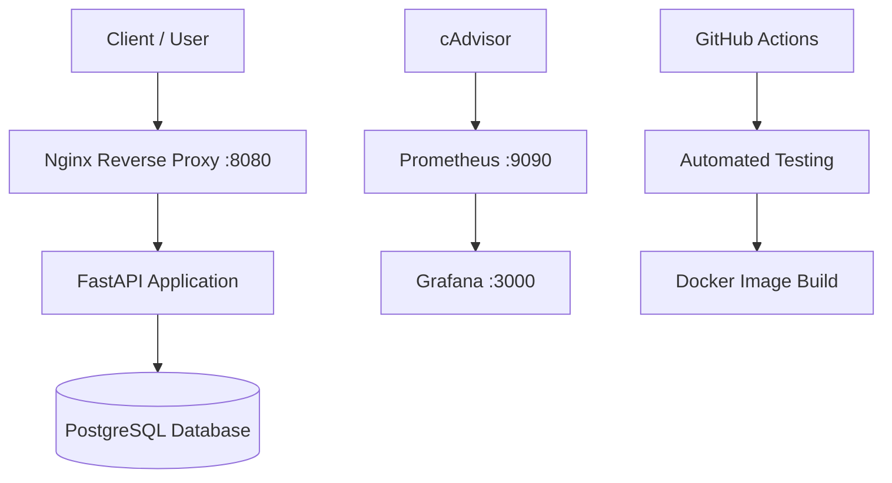

# Docker Multi-Container Inventory Platform

**Platform manajemen inventaris berbasis Docker dengan CI, database persisten, reverse proxy, dan monitoring.**

<p align="center">
  
  
  
  
  
</p>

<p align="center">
  <a href="https://github.com/defrisdoloksaribu/docker-multi-container-platform/actions/workflows/ci.yml">
    
  </a>
</p>

---

## Tentang Proyek

Proyek ini merupakan implementasi **containerized inventory management platform** menggunakan Docker Compose, FastAPI, PostgreSQL, dan Nginx, dilengkapi monitoring menggunakan Prometheus, Grafana, dan cAdvisor.

Tujuan proyek ini adalah mempraktikkan workflow DevOps secara langsung, mulai dari menjalankan multi-container application, mengelola database, melakukan automated testing, hingga memantau resource container.

Proyek ini dikembangkan sebagai bagian dari portofolio untuk persiapan magang di bidang **DevOps, Cloud Infrastructure, dan System Administration**.

## Arsitektur Sistem



### Komponen Utama

| Komponen | Fungsi |
|---|---|
| Docker Compose | Mengelola dan menjalankan seluruh service |
| Nginx | Reverse proxy untuk akses aplikasi |
| FastAPI | Menyediakan REST API inventaris |
| PostgreSQL | Menyimpan data inventaris secara persisten |
| cAdvisor | Mengumpulkan metrik resource container |
| Prometheus | Mengumpulkan dan menyediakan query metrik |
| Grafana | Menampilkan visualisasi monitoring |
| GitHub Actions | Menjalankan automated testing dan Docker image build |

## Teknologi yang Digunakan

- **Containerization:** Docker, Docker Compose
- **Backend:** Python, FastAPI
- **Database:** PostgreSQL 17
- **Reverse Proxy:** Nginx
- **Monitoring:** Prometheus, Grafana, cAdvisor
- **Testing:** pytest
- **CI:** GitHub Actions

## Fitur Proyek

- Multi-container orchestration menggunakan Docker Compose.
- Health check untuk memeriksa kondisi service.
- Persistent storage menggunakan Docker volume.
- Reverse proxy melalui Nginx.
- Konfigurasi database menggunakan environment variables.
- Application container berjalan sebagai non-root user.
- REST API untuk membuat dan mengambil data inventaris.
- Automated testing dan Docker image build melalui GitHub Actions.
- Pengumpulan metrik container menggunakan cAdvisor dan Prometheus.
- Dashboard monitoring menggunakan Grafana.
- Pengujian pemulihan API setelah container dihentikan.

## Instalasi dan Menjalankan Proyek

### Prasyarat

Pastikan aplikasi berikut sudah terpasang:

- [Docker Desktop](https://www.docker.com/products/docker-desktop/)
- [Git](https://git-scm.com/)

### 1. Clone Repository

```cmd
git clone https://github.com/defrisdoloksaribu/docker-multi-container-platform.git
cd docker-multi-container-platform
```

### 2. Konfigurasi Environment

Buat file `.env` berdasarkan file contoh yang tersedia:

```cmd
copy .env.example .env
```

Edit file `.env`, kemudian sesuaikan kredensial database dan password administrator Grafana.

> **Security:** Jangan mengunggah file `.env`, password, atau secret ke repository publik.

### 3. Jalankan Seluruh Service

```cmd
docker compose up --build -d
```

### 4. Periksa Status Container

```cmd
docker compose ps
```

Pastikan seluruh service berjalan sesuai konfigurasi dan health check yang tersedia.

### 5. Periksa API

```cmd
curl http://localhost:8080/health
```

Contoh respons yang diharapkan:

```json
{
  "status": "healthy",
  "database": "connected"
}
```

## API Endpoints

Aplikasi diakses melalui Nginx pada `http://localhost:8080`.

| Method | Endpoint | Keterangan |
|---|---|---|
| GET | `/health` | Memeriksa kondisi API dan koneksi database |
| GET | `/items` | Mengambil daftar inventaris |
| POST | `/items` | Menambahkan item inventaris |

### Mengambil Data Inventaris

```cmd
curl http://localhost:8080/items
```

### Menambahkan Item

Contoh berikut menggunakan Windows CMD:

```cmd
curl -X POST http://localhost:8080/items -H "Content-Type: application/json" -d "{\"name\":\"Keyboard\",\"quantity\":10}"
```

## Monitoring dan Observability

Monitoring digunakan untuk melihat kondisi service serta metrik resource container melalui Prometheus dan Grafana.

| Service | URL | Fungsi |
|---|---|---|
| API | [localhost:8080](http://localhost:8080) | Akses aplikasi |
| Prometheus | [localhost:9090](http://localhost:9090) | Query metrik |
| Prometheus Targets | [localhost:9090/targets](http://localhost:9090/targets) | Memeriksa status target monitoring |
| Grafana | [localhost:3000](http://localhost:3000) | Melihat dashboard monitoring |

Login Grafana menggunakan kredensial administrator yang telah dikonfigurasi di file `.env`.

### Contoh Query Prometheus

Memeriksa apakah target cAdvisor berhasil di-scrape:

```promql
up{job="cadvisor"}
```

Nilai `1` menunjukkan target dapat dijangkau dan metriknya berhasil diambil.

Melihat metrik penggunaan memori container:

```promql
container_memory_working_set_bytes
```

Metrik tersebut dapat digunakan sebagai dasar visualisasi resource monitoring di Grafana.

## Automated Testing dan CI

GitHub Actions menjalankan workflow CI ketika terdapat push atau pull request ke branch `main`.

Tahapan workflow meliputi:

1. Checkout source code.
2. Setup Python.
3. Install development dependencies.
4. Menjalankan automated tests menggunakan pytest.
5. Build Docker image.

Untuk menjalankan test secara lokal menggunakan Docker:

```cmd
docker run --rm -v "%cd%:/workspace" -w /workspace python:3.12-slim sh -c "pip install --no-cache-dir -r requirements-dev.txt && python -m pytest tests"
```

**Hasil pengujian terakhir:** 3 test berhasil (`3 passed`).

## Recovery dan Persistence Testing

API telah diuji dengan menghentikan container secara paksa, kemudian menjalankannya kembali.

```cmd
docker compose kill api
docker compose up -d api
docker compose ps
```

Setelah API dijalankan kembali, health endpoint berhasil merespons dan koneksi database kembali tersedia.

Pengujian ini membuktikan bahwa API dapat dipulihkan melalui perintah manual. Automatic recovery tanpa intervensi manual belum dinyatakan terverifikasi.

## Struktur Repository

```text
docker-multi-container-platform/
├── .github/
│   └── workflows/
│       └── ci.yml
├── app/
│   ├── __init__.py
│   ├── main.py
│   └── requirements.txt
├── monitoring/
│   └── prometheus/
│       └── prometheus.yml
├── tests/
├── compose.yaml
├── Dockerfile
├── .dockerignore
├── .gitignore
├── .env.example
├── requirements.txt
├── requirements-dev.txt
└── README.md
```

*Catatan: struktur di atas merangkum file utama proyek; sesuaikan jika terdapat perbedaan pada repository aktual.*

## Cleanup

Untuk menghentikan service tanpa menghapus data pada named volume:

```cmd
docker compose down
```

Hindari `docker compose down -v` jika masih ingin mempertahankan data database.

## Author

**Defris Doloksaribu**

- GitHub: [@defrisdoloksaribu](https://github.com/defrisdoloksaribu)
- Repository: [docker-multi-container-platform](https://github.com/defrisdoloksaribu/docker-multi-container-platform)

---

*Built to practice container orchestration, CI automation, persistent storage, and infrastructure monitoring.*
