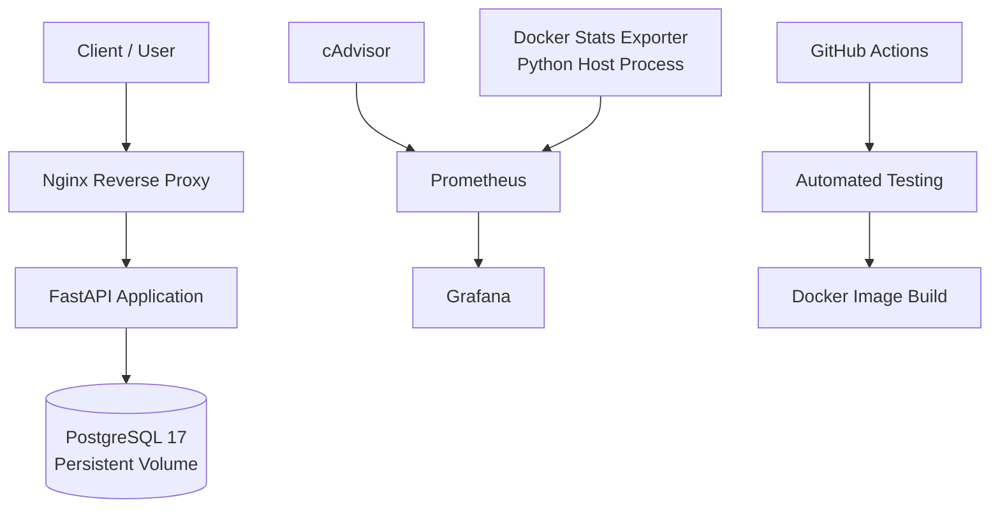
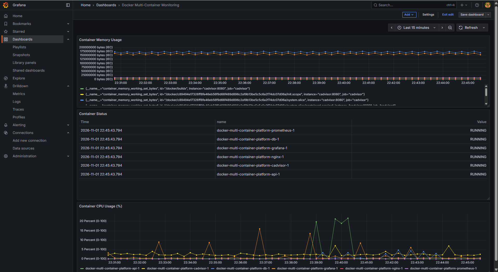

# Docker Multi-Container Inventory Platform

**A containerized inventory platform built with Docker, FastAPI, PostgreSQL, Nginx, and an integrated monitoring stack.**

[](https://github.com/defrisdoloksaribu/docker-multi-container-platform/actions/workflows/ci.yml)


**Author:** Defris Doloksaribu  
**Project Category:** DevOps / Containerization / Infrastructure Monitoring  
**Repository:** [GitHub](https://github.com/defrisdoloksaribu/docker-multi-container-platform)

---

## 1. Project Overview

Docker Multi-Container Inventory Platform merupakan proyek portfolio untuk membangun dan mengelola aplikasi inventory menggunakan **Docker multi-container architecture**.

Aplikasi menggunakan FastAPI sebagai REST API, PostgreSQL sebagai persistent database, dan Nginx sebagai reverse proxy. Seluruh application services dikelola menggunakan Docker Compose.

Untuk infrastructure monitoring, proyek ini mengintegrasikan Prometheus, cAdvisor, Grafana, serta custom Python-based Docker Stats Exporter untuk mengumpulkan informasi CPU, memory, dan container status.

Selain itu, GitHub Actions digunakan untuk menjalankan automated testing dan Docker image build melalui CI workflow.

Project ini berfokus pada penerapan practical DevOps workflow, mulai dari application containerization, service management, monitoring, hingga continuous integration.

## 2. Key Features

- **Multi-Container Management** — Mengelola enam application dan monitoring services menggunakan Docker Compose.
- **REST API** — Menyediakan endpoint untuk inventory management dan application health check.
- **Persistent Database** — Menggunakan PostgreSQL dengan Docker named volume.
- **Reverse Proxy** — Mengatur application traffic menggunakan Nginx.
- **Health Checks** — Memeriksa kondisi service yang memiliki health check.
- **Automated Testing** — Menjalankan unit tests menggunakan pytest.
- **Continuous Integration** — Mengotomatisasi testing dan Docker image build melalui GitHub Actions.
- **Infrastructure Monitoring** — Menggunakan Prometheus dan cAdvisor untuk metric collection.
- **Custom Metrics Exporter** — Mengumpulkan CPU, memory, dan status container menggunakan Python.
- **Grafana Dashboard** — Menampilkan container status dan resource utilization.
- **Recovery Testing** — Menguji API recovery melalui manual container restart.

## 3. System Architecture



### Service Components

| Service | Technology | Responsibility |
|---|---|---|
| API | FastAPI | Menangani inventory requests |
| Database | PostgreSQL 17 | Persistent data storage |
| Reverse Proxy | Nginx | Request routing |
| Container Monitoring | cAdvisor | Container resource metrics |
| Metrics Collection | Prometheus | Metrics scraping and querying |
| Visualization | Grafana | Monitoring dashboard |

**Additional component:** Docker Stats Exporter merupakan Python process yang berjalan di host Windows, bukan Docker Compose service.

## 4. Technology Stack

| Category | Tools |
|---|---|
| Containerization | Docker, Docker Compose |
| Backend | Python, FastAPI |
| Database | PostgreSQL 17 |
| Reverse Proxy | Nginx |
| Monitoring | Prometheus, cAdvisor, Grafana |
| Metrics Exporter | Python |
| Testing | pytest |
| CI/CD | GitHub Actions (CI) |
| Version Control | Git, GitHub |

## 5. Getting Started

### Prerequisites

Pastikan software berikut sudah terinstall:

- Docker Desktop
- Git
- Python 3

Docker Desktop harus berjalan dengan Linux containers enabled.

### Clone Repository

```cmd
git clone https://github.com/defrisdoloksaribu/docker-multi-container-platform.git
cd docker-multi-container-platform
```

### Environment Configuration

Buat file `.env` dari template:

```cmd
copy .env.example .env
```

Sesuaikan PostgreSQL credentials dan Grafana administrator password berdasarkan konfigurasi `.env.example`.

> Security note: Jangan commit `.env`, password, token, atau credentials ke public repository.

### Start Application

```cmd
docker compose up --build -d
```

Perintah ini akan build application image dan menjalankan seluruh Docker Compose services.

### Verify Containers

```cmd
docker compose ps
```

Pastikan semua service berjalan dan configured health checks menunjukkan status sehat.

### Start Custom Exporter

Buka CMD baru dari project directory:

```cmd
py tools\docker-stats-exporter\exporter.py
```

Biarkan proses exporter tetap berjalan selama monitoring berlangsung.

## 6. Application Endpoints

| Component | URL | Description |
|---|---|---|
| Inventory API | http://localhost:8080 | API access through Nginx |
| Prometheus | http://localhost:9090 | Metrics query interface |
| Prometheus Targets | http://localhost:9090/targets | Target monitoring status |
| Grafana | http://localhost:3000 | Monitoring dashboard |
| Custom Exporter | http://localhost:9713/metrics | Custom container metrics |

### API Reference

| Method | Endpoint | Function |
|---|---|---|
| GET | `/health` | Application and database health check |
| GET | `/items` | Retrieve inventory data |
| POST | `/items` | Create inventory item |

Example health check:

```cmd
curl http://localhost:8080/health
```

Example response:

```json
{
  "status": "healthy",
  "database": "connected"
}
```

## 7. Monitoring Dashboard

Monitoring stack menggunakan Prometheus sebagai metrics collection system dan Grafana sebagai visualization platform.

Dashboard utama menyediakan tiga monitoring panels:

1. **Container Status** — Menampilkan status container yang terdeteksi exporter.
2. **Container CPU Usage** — Menampilkan CPU utilization setiap container.
3. **Container Memory Usage** — Menampilkan penggunaan memory container.



### Example Prometheus Queries

Container status:

```promql
docker_container_up
```

CPU utilization:

```promql
docker_container_cpu_percent
```

Memory usage:

```promql
docker_container_memory_usage_bytes
```

Exporter availability:

```promql
up{job="docker-stats-exporter"}
```

## 8. Continuous Integration

GitHub Actions digunakan untuk menjalankan CI workflow pada event `push` dan `pull_request` ke branch `main`.

Workflow mencakup:

1. Source code checkout.
2. Python environment setup.
3. Development dependencies installation.
4. Automated testing menggunakan pytest.
5. Docker image build.

Run local tests:

```cmd
docker run --rm -v "%cd%:/workspace" -w /workspace python:3.12-slim sh -c "pip install --no-cache-dir -r requirements-dev.txt && python -m pytest tests"
```

Previously recorded local test result:

```text
3 passed
```

Periksa GitHub Actions untuk hasil CI terbaru.

**Note:** Implementasi CI saat ini mencakup testing dan image build. Automatic deployment ke production environment belum dikonfigurasi sebagai fitur yang terverifikasi.

## 9. Testing and Validation

Beberapa skenario pengujian yang telah dilakukan:

| Test Scenario | Validation |
|---|---|
| API Health Check | Memastikan API dan database dapat diakses |
| Container Status | Memastikan enam container terdeteksi exporter |
| Prometheus Targets | Memeriksa status target monitoring |
| CPU Monitoring | Memeriksa CPU metrics |
| Memory Monitoring | Memeriksa memory metrics |
| API Recovery | Menguji pemulihan API setelah manual restart |
| Database Persistence | Memeriksa data setelah database container dibuat ulang |
| CI Workflow | Memeriksa automated testing dan image build |

### API Recovery Test

```cmd
docker compose kill api
docker compose up -d api
docker compose ps api
```

API kemudian diperiksa kembali menggunakan health endpoint.

Pengujian ini membuktikan manual recovery, bukan automatic self-healing tanpa intervensi.

### Database Persistence Test

```cmd
docker compose up -d --force-recreate db
docker compose ps
```

Setelah database sehat kembali, periksa data melalui endpoint inventory.

## 10. Documentation

Dokumentasi teknis tambahan tersedia di folder [`docs/`](docs/).

| Document | Description |
|---|---|
| [System Architecture](docs/architecture/ARCHITECTURE.md) | Arsitektur sistem dan komunikasi antarservice |
| [Installation Guide](docs/guides/INSTALLATION.md) | Instalasi dan konfigurasi environment |
| [Monitoring Guide](docs/guides/MONITORING.md) | Prometheus, Grafana, dan custom exporter |
| [Testing Guide](docs/guides/TESTING.md) | Test scenarios dan validation |
| [Troubleshooting](docs/guides/TROUBLESHOOTING.md) | Masalah umum dan cara penanganan |
| [Project Screenshots](docs/screenshots/README.md) | Bukti implementasi dan hasil monitoring |
| [Project Report](docs/laporan/README.md) | Dokumentasi laporan proyek |

## 11. Known Limitations

- Project deployment masih menggunakan local Docker Compose environment.
- CI workflow berfokus pada testing dan Docker image build.
- API recovery yang diuji dilakukan secara manual.
- Custom exporter harus dijalankan secara terpisah pada host.
- Status metric exporter saat ini mencakup container yang dikembalikan oleh `docker stats`, bukan seluruh stopped containers.
- Production alerting dan notification belum diverifikasi.
- Security hardening untuk monitoring dan container access masih dapat ditingkatkan.

## 12. Future Improvements

- Menambahkan API integration tests.
- Mengimplementasikan PostgreSQL backup and restore.
- Menambahkan Prometheus alert rules dan notification.
- Meningkatkan container security.
- Menyempurnakan custom exporter untuk mendeteksi stopped containers.
- Mengembangkan deployment automation.
- Mengevaluasi Kubernetes orchestration.

## 13. Author

**Defris Doloksaribu**

- GitHub: [@defrisdoloksaribu](https://github.com/defrisdoloksaribu)
- Repository: [docker-multi-container-platform](https://github.com/defrisdoloksaribu/docker-multi-container-platform)

---

*Built as a hands-on DevOps portfolio project focused on containerization, CI automation, persistent storage, and infrastructure monitoring.*
