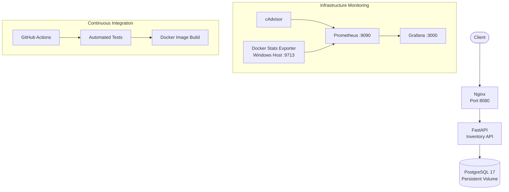

# Docker Multi-Container Inventory Platform

**A containerized inventory platform featuring REST API services, persistent database storage, automated CI, and integrated infrastructure monitoring.**

[](https://github.com/defrisdoloksaribu/docker-multi-container-platform/actions/workflows/ci.yml)


**Author:** Defris Doloksaribu  
**Focus:** DevOps · Containerization · CI · Infrastructure Monitoring  
**Repository:** [docker-multi-container-platform](https://github.com/defrisdoloksaribu/docker-multi-container-platform)

---

## 1. Project Overview

The **Docker Multi-Container Inventory Platform** is a practical DevOps project designed to demonstrate containerized application deployment, persistent storage, continuous integration, and infrastructure monitoring.

The application uses **FastAPI** to provide inventory REST API endpoints, **PostgreSQL** for persistent data storage, and **Nginx** as a reverse proxy.

Infrastructure monitoring is implemented using **Prometheus, cAdvisor, and Grafana**, supported by a custom Python-based Docker Stats Exporter. **GitHub Actions** automates application testing and Docker image builds.

### Key Features

- Multi-container application orchestration using Docker Compose.
- REST API development with FastAPI.
- Persistent database storage using PostgreSQL.
- Reverse proxy configuration with Nginx.
- Container resource monitoring using Prometheus and cAdvisor.
- Custom Docker metrics collection using Python.
- CI workflow for automated testing and Docker image builds.

## 2. System Architecture

The following diagram illustrates the application flow, monitoring components, and continuous integration workflow.



### Service Components

The platform consists of six Docker Compose services:

| Service | Responsibility |
|---|---|
| `api` | Provides inventory REST API endpoints using FastAPI |
| `db` | Stores inventory data using PostgreSQL |
| `nginx` | Routes incoming requests to the API |
| `cadvisor` | Collects container resource metrics |
| `prometheus` | Collects and stores monitoring metrics |
| `grafana` | Visualizes monitoring data through dashboards |

**Custom Docker Stats Exporter** runs separately on the Windows host. It is not part of the six Docker Compose services.

## 3. Technology Stack

| Category | Technology |
|---|---|
| Application | Python, FastAPI |
| Database | PostgreSQL 17 |
| Containerization | Docker, Docker Compose |
| Reverse Proxy | Nginx |
| Monitoring | Prometheus, cAdvisor, Grafana |
| Custom Metrics | Python Docker Stats Exporter |
| Continuous Integration | GitHub Actions |
| Testing | pytest |

## 4. Getting Started

### Prerequisites

Make sure the following tools are installed:

- Docker Desktop with Linux containers enabled.
- Git.
- Python 3 for the custom metrics exporter.

### Clone the Repository

```cmd
git clone https://github.com/defrisdoloksaribu/docker-multi-container-platform.git
cd docker-multi-container-platform
copy .env.example .env
```

Configure the required credentials and environment variables in the `.env` file before starting the services.

### Start the Platform

```cmd
docker compose up --build -d
docker compose ps
```

The command starts the application and monitoring services in detached mode.

### Start the Custom Exporter

Open a second CMD terminal from the project root directory:

```cmd
py tools\docker-stats-exporter\exporter.py
```

Keep the exporter process running while custom Docker metrics are required.

## 5. Service Endpoints

| Component | URL |
|---|---|
| Inventory API | http://localhost:8080 |
| API Health Check | http://localhost:8080/health |
| Inventory Items | http://localhost:8080/items |
| Prometheus | http://localhost:9090 |
| Prometheus Targets | http://localhost:9090/targets |
| Grafana | http://localhost:3000 |
| Custom Exporter Metrics | http://localhost:9713/metrics |

### Verify the API

Run the following commands from Windows CMD:

```cmd
curl.exe http://localhost:8080/health
curl.exe http://localhost:8080/items
```

The health endpoint can be used to verify API availability, while the items endpoint returns inventory data.

### Grafana Data Source

Configure Prometheus as the Grafana data source using the internal Docker service address:

```text
http://prometheus:9090
```

Use the credentials configured in `.env` to access Grafana.

## 6. Infrastructure Monitoring

The platform uses Prometheus and cAdvisor to collect and monitor container metrics.

The custom Python exporter provides additional Docker resource metrics:

| Metric | Description |
|---|---|
| `docker_container_cpu_percent` | Container CPU usage percentage |
| `docker_container_memory_usage_bytes` | Container memory usage in bytes |
| `docker_container_memory_limit_bytes` | Container memory limit in bytes |
| `docker_container_up` | Container availability status |

### Example PromQL Queries

```promql
up{job="cadvisor"}
up{job="docker-stats-exporter"}
docker_container_cpu_percent
docker_container_memory_usage_bytes
docker_container_up
```

**Exporter limitation:** The custom exporter retrieves container statistics using `docker stats --no-stream`. Stopped containers may not appear in the returned metrics. The exporter must also be started manually on the Windows host.

## 7. Continuous Integration and Testing

GitHub Actions runs the CI workflow when changes are pushed or pull requests are opened against the `main` branch.

### CI Pipeline Stages

1. Check out the repository source code.
2. Set up the Python environment.
3. Install development dependencies.
4. Execute automated tests using pytest.
5. Build the Docker image.

A previously recorded local test result was **3 passed**. Check the repository's **Actions** tab for the latest workflow execution status.

### Validation and Manual Tests

The project validation activities include:

- API health endpoint verification.
- Container status and monitoring checks.
- Manual API restart testing.
- Database persistence testing after recreating the database container while retaining its named volume.

### Implementation Scope

The API recovery test uses a **manual restart**, not automatic self-healing.

The current GitHub Actions workflow performs automated testing and Docker image building. It does not yet implement automatic deployment.

## 8. Project Documentation and Evidence

Detailed documentation is available in the `docs/` directory.

| Document | Description |
|---|---|
| [System Architecture](docs/architecture/ARCHITECTURE.md) | System design and service communication |
| [Installation Guide](docs/guides/INSTALLATION.md) | Environment setup and deployment instructions |
| [Monitoring Guide](docs/guides/MONITORING.md) | Prometheus, Grafana, and exporter configuration |
| [Testing Guide](docs/guides/TESTING.md) | Testing scenarios and validation procedures |
| [Troubleshooting Guide](docs/guides/TROUBLESHOOTING.md) | Common issues and troubleshooting steps |
| [Project Report](docs/laporan/README.md) | Project report and implementation documentation |
| [Screenshot Evidence](docs/screenshots/README.md) | Screenshot index and implementation evidence |

See the [screenshots directory](docs/screenshots/) for visual evidence of the API, Docker containers, Prometheus, Grafana, and GitHub Actions.

## 9. Current Limitations and Future Improvements

The current implementation focuses on a local Docker Compose environment.

Potential improvements include:

- Adding integration tests for application and database interactions.
- Implementing automated database backup and restore procedures.
- Configuring Prometheus alert rules.
- Improving container security and resource management.
- Implementing an automated deployment workflow.

These items are future development goals and are not claimed as completed features.

---

**Defris Doloksaribu** · [GitHub Profile](https://github.com/defrisdoloksaribu)

