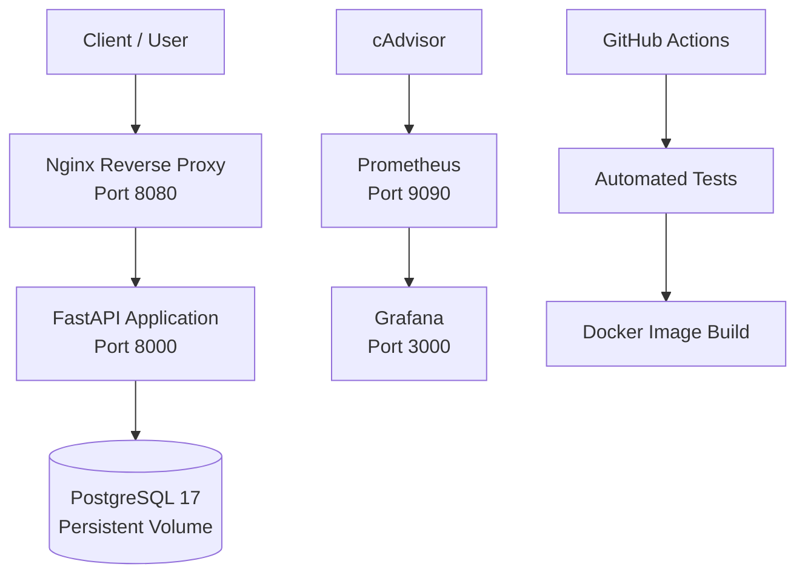

# Docker Multi-Container Inventory Platform

**A containerized inventory API with persistent storage, automated testing, reverse proxy, and infrastructure monitoring.**

[](https://github.com/defrisdoloksaribu/docker-multi-container-platform/actions/workflows/ci.yml)


---

## Overview

Docker Multi-Container Inventory Platform adalah proyek portofolio untuk mempraktikkan workflow DevOps melalui aplikasi inventaris berbasis container.

Platform ini menggabungkan FastAPI sebagai REST API, PostgreSQL sebagai database, Nginx sebagai reverse proxy, serta Prometheus, cAdvisor, dan Grafana untuk monitoring resource container.

GitHub Actions digunakan untuk menjalankan automated tests dan membangun Docker image secara otomatis ketika terdapat perubahan pada repository.

Proyek ini dikembangkan untuk memperkuat keterampilan praktis dalam **DevOps, containerization, CI automation, database persistence, dan infrastructure monitoring** sebagai persiapan magang.

## Key Features

- **Container orchestration** — mengelola enam service menggunakan Docker Compose.
- **REST API** — menyediakan endpoint untuk health check dan data inventaris.
- **Persistent storage** — menyimpan data PostgreSQL pada Docker named volume.
- **Reverse proxy** — meneruskan request aplikasi melalui Nginx.
- **Health checks** — memeriksa kesiapan API, database, dan Nginx.
- **Automated testing** — menjalankan pengujian Python menggunakan pytest.
- **Continuous integration** — menjalankan pengujian dan Docker image build melalui GitHub Actions.
- **Container monitoring** — mengumpulkan metrik menggunakan cAdvisor dan Prometheus.
- **Monitoring dashboard** — memvisualisasikan metrik melalui Grafana.
- **Recovery testing** — memverifikasi pemulihan API setelah container dihentikan dan dijalankan kembali secara manual.

## Architecture



### Service Overview

| Service | Technology | Responsibility |
|---|---|---|
| `api` | Python, FastAPI | Menyediakan REST API inventaris |
| `db` | PostgreSQL 17 | Menyimpan data inventaris |
| `nginx` | Nginx | Menjadi reverse proxy aplikasi |
| `cadvisor` | cAdvisor | Mengumpulkan metrik container |
| `prometheus` | Prometheus | Mengumpulkan dan menyediakan query metrik |
| `grafana` | Grafana | Memvisualisasikan metrik monitoring |

Docker Compose mengatur lifecycle service, konfigurasi jaringan, health checks, restart policies, dan persistent volumes.

## Technology Stack

| Category | Technology |
|---|---|
| Containerization | Docker, Docker Compose |
| Backend | Python, FastAPI |
| Database | PostgreSQL 17 |
| Reverse proxy | Nginx |
| Monitoring | Prometheus, cAdvisor, Grafana |
| Testing | pytest |
| CI | GitHub Actions |
| Version control | Git, GitHub |

## Getting Started

### Prerequisites

Pastikan perangkat sudah memiliki:

- [Docker Desktop](https://www.docker.com/products/docker-desktop/)
- [Git](https://git-scm.com/)

Docker Desktop harus berjalan dengan Linux containers sebelum menjalankan perintah Docker Compose.

### 1. Clone Repository

```cmd
git clone https://github.com/defrisdoloksaribu/docker-multi-container-platform.git
cd docker-multi-container-platform
```

### 2. Configure Environment Variables

Buat file `.env` dari template:

```cmd
copy .env.example .env
```

Buka `.env` menggunakan editor teks dan isi variabel yang diperlukan berdasarkan template tersebut, termasuk kredensial PostgreSQL dan password administrator Grafana.

Jangan menggunakan password contoh untuk deployment yang terekspos ke jaringan. Jangan mengunggah `.env`, password, token, atau secret ke repository.

### 3. Start the Platform

```cmd
docker compose up --build -d
```

Perintah ini membangun image aplikasi dan menjalankan seluruh service di background.

### 4. Verify Containers

```cmd
docker compose ps
```

Pastikan service berjalan dan health checks yang tersedia mencapai status sehat.

Untuk memeriksa konfigurasi Compose tanpa menjalankan ulang service:

```cmd
docker compose config --quiet
```

### 5. Verify the API

Health endpoint:

```cmd
curl http://localhost:8080/health
```

Contoh respons:

```json
{
  "status": "healthy",
  "database": "connected"
}
```

Ambil data inventaris:

```cmd
curl http://localhost:8080/items
```

Contoh data yang telah diverifikasi selama pengujian:

```json
[
  {
    "id": 1,
    "name": "Keyboard",
    "quantity": 10
  }
]
```

Data tersebut merupakan contoh hasil pengujian lokal, bukan data yang dijamin tersedia pada setiap instalasi baru.

## API Reference

API diakses melalui Nginx pada `http://localhost:8080`.

| Method | Endpoint | Description |
|---|---|---|
| `GET` | `/health` | Memeriksa kondisi API dan koneksi database |
| `GET` | `/items` | Mengambil daftar inventaris |
| `POST` | `/items` | Menambahkan item inventaris |

### Add an Inventory Item

Contoh request menggunakan Windows CMD:

```cmd
curl -X POST http://localhost:8080/items -H "Content-Type: application/json" -d "{\"name\":\"Mouse\",\"quantity\":5}"
```

Request ini merupakan contoh penggunaan endpoint. Verifikasi respons aktual untuk memastikan item berhasil dibuat.

## Monitoring and Observability

Platform menyediakan tiga antarmuka monitoring dan aplikasi:

| Component | URL | Purpose |
|---|---|---|
| Inventory API | [localhost:8080](http://localhost:8080) | Akses API melalui Nginx |
| Prometheus | [localhost:9090](http://localhost:9090) | Query metrik |
| Prometheus Targets | [localhost:9090/targets](http://localhost:9090/targets) | Memeriksa status target monitoring |
| Grafana | [localhost:3000](http://localhost:3000) | Visualisasi metrik |

Login Grafana menggunakan username dan password yang dikonfigurasi melalui environment variables.

### Prometheus Queries

Memeriksa status target cAdvisor:

```promql
up{job="cadvisor"}
```

Nilai `1` menunjukkan target berhasil dijangkau dan metrik berhasil dikumpulkan.

Memeriksa metrik penggunaan memori container:

```promql
container_memory_working_set_bytes
```

Metrik ini dapat digunakan untuk membuat visualisasi penggunaan memori. Untuk dashboard yang lebih akurat, filter seri berdasarkan container atau label yang sesuai dengan lingkungan pengujian.

## Continuous Integration

Workflow GitHub Actions dijalankan pada event `push` dan `pull_request` ke branch `main`.

Tahapan CI yang dikonfigurasi:

1. Checkout source code.
2. Setup Python.
3. Install development dependencies.
4. Menjalankan automated tests menggunakan pytest.
5. Membangun Docker image.

### Local Test

Pengujian dapat dijalankan melalui container Python sementara dari Windows CMD:

```cmd
docker run --rm -v "%cd%:/workspace" -w /workspace python:3.12-slim sh -c "pip install --no-cache-dir -r requirements-dev.txt && python -m pytest tests"
```

Hasil pengujian lokal yang telah tercatat:

```text
3 passed
```

Hasil tersebut merujuk pada eksekusi pengujian sebelumnya. Periksa hasil CI terbaru untuk status pada commit yang sedang aktif.

**Catatan:** workflow yang dijelaskan di sini merupakan continuous integration untuk testing dan build. Jangan menganggap deployment otomatis sudah tersedia kecuali workflow deployment terpisah benar-benar dikonfigurasi dan diuji.

## Reliability and Persistence Testing

### API Recovery Test

API diuji dengan menghentikan container secara paksa, kemudian menjalankannya kembali:

```cmd
docker compose kill api
docker compose up -d api
docker compose ps api
```

Setelah API dijalankan kembali, endpoint health check berhasil merespons dan data inventaris tetap dapat diakses.

Pengujian ini memverifikasi **pemulihan melalui tindakan manual**. Pengujian tersebut tidak membuktikan automatic recovery tanpa intervensi pengguna.

### Database Persistence Test

Container PostgreSQL dibuat ulang tanpa menghapus named volume:

```cmd
docker compose up -d --force-recreate db
docker compose ps
```

Setelah database kembali sehat, endpoint berikut diperiksa:

```cmd
curl http://localhost:8080/health
curl http://localhost:8080/items
```

Data inventaris `Keyboard` dengan jumlah `10` tetap tersedia setelah container database dibuat ulang. Hal ini mendukung verifikasi persistensi data melalui Docker volume pada skenario pengujian tersebut.

### Stop the Platform

Untuk menghentikan service tanpa menghapus named volumes:

```cmd
docker compose down
```

Hindari `docker compose down -v` jika data database, metrik Prometheus, dan konfigurasi dashboard Grafana masih ingin dipertahankan.

## Repository Structure

```text
docker-multi-container-platform/
├── .github/
│   └── workflows/
│       └── ci.yml
├── app/
│   ├── __init__.py
│   ├── main.py
│   └── requirements.txt
├── docs/
│   ├── laporan/
│   │   ├── README.md
│   │   ├── BAB-I-PENDAHULUAN.md
│   │   ├── BAB-II-LANDASAN-TEORI.md
│   │   ├── BAB-III-METODOLOGI.md
│   │   ├── BAB-IV-IMPLEMENTASI-DAN-PENGUJIAN.md
│   │   ├── BAB-V-KESIMPULAN-DAN-SARAN.md
│   │   └── DAFTAR-PUSTAKA.md
│   └── screenshots/
│       └── README.md
├── monitoring/
│   └── prometheus/
│       └── prometheus.yml
├── nginx/
│   └── default.conf
├── tests/
├── .dockerignore
├── .env.example
├── .gitignore
├── compose.yaml
├── Dockerfile
├── README.md
├── requirements.txt
└── requirements-dev.txt
```

Struktur di atas merangkum file utama proyek. File tambahan dapat tersedia sesuai implementasi repository.

## Documentation

Dokumentasi laporan akademik dan pengujian tersedia di folder [`docs/`](docs/).

- [Laporan proyek](docs/laporan/README.md)
- [Dokumentasi screenshot](docs/screenshots/README.md)

Screenshot yang ditampilkan sebagai bukti implementasi sebaiknya berasal dari hasil pengujian aktual. Jika masih menggunakan ilustrasi, tandai sebagai ilustrasi dan jangan menyajikannya sebagai hasil eksekusi nyata.

## Known Limitations

- Deployment masih berorientasi pada lingkungan lokal menggunakan Docker Compose.
- CI melakukan automated testing dan Docker image build; deployment otomatis belum dinyatakan sebagai bagian dari pipeline yang telah diverifikasi.
- Pemulihan API yang diuji dilakukan secara manual.
- Monitoring yang tersedia berfokus pada metrik Prometheus dan cAdvisor. Alerting produksi belum dinyatakan terverifikasi.
- Konfigurasi cAdvisor memerlukan peninjauan hak akses sebelum digunakan pada lingkungan produksi.
- Backup dan restore database belum dinyatakan teruji dalam dokumentasi ini.

Bagian ini membedakan fitur yang sudah diverifikasi dari pengembangan lanjutan yang masih dapat dilakukan.

## Future Improvements

- Menambahkan integration tests untuk API dan database.
- Menguji backup dan restore PostgreSQL.
- Menambahkan alert rules pada Prometheus dan notifikasi monitoring.
- Memperketat security hardening container dan akses monitoring.
- Mengembangkan deployment pipeline setelah CI stabil.
- Mengevaluasi orchestration dan automated recovery yang lebih lanjut.

## Author

**Defris Doloksaribu**

- GitHub: [@defrisdoloksaribu](https://github.com/defrisdoloksaribu)
- Repository: [docker-multi-container-platform](https://github.com/defrisdoloksaribu/docker-multi-container-platform)

---

*Built as a hands-on DevOps portfolio project focused on container orchestration, CI automation, persistent storage, and infrastructure monitoring.*
